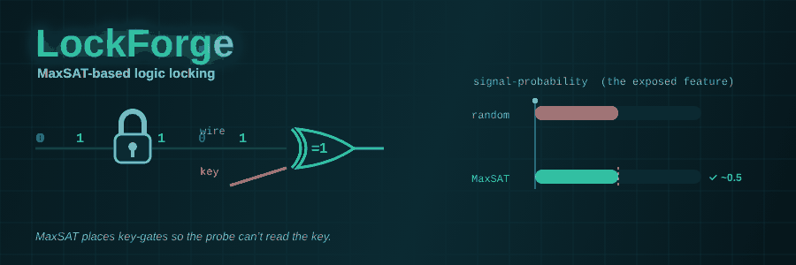

<p align="center">
  
</p>

# LockForge Reproduction — MaxSAT-Based Logic Locking

**Agent-Based Paper Reproduction · GenAI-Based Chip Design (ECE-GY 9941)**
Sruthi Raghavan (sr7892)

Reproduction of the core methodology of:

> **"Concealing Exposed Circuit Features Through a MaxSAT-Based Logic Locking Method"**
> (Logic-Locking sheet, paper #8)

A pure-Python, CPU-only implementation produced with an AI agent (per the LockForge
workflow). It locks a gate-level circuit by **using MaxSAT to place key-gates that
conceal an "exposed feature" — signal-probability skew — which probability/structural
attacks exploit**, and evaluates the result against a random-placement baseline and an
oracle-guided SAT attack.

---

## What the paper does (and what we reproduce)

When you insert an XOR/XNOR key-gate on a wire, the wire's **signal-probability skew**
(how far `P(wire = 1)` is from 0.5) is an *exposed feature*: a structural / signal-
probability-skew (SPS) style attacker can use it to guess the key-bit's polarity. A wire
whose probability is ≈ 0.5 hides the key bit.

The paper formulates key-gate placement as a **MaxSAT optimisation** that conceals these
exposed features. We reproduce that core idea:

| Element | Our reproduction |
|---|---|
| **Exposed feature** | Signal-probability skew `|P(wire) − 0.5|`, estimated by simulation |
| **Objective** | Maximise concealment `1 − 2·skew` **and** corruptibility `|output cone|/|POs|` |
| **Optimiser** | Weighted-partial **MaxSAT** (RC2): at-most-K key-gates + a structural "don't stack key-gates on ancestor/descendant wires" constraint + rank-weighted rewards |
| **Lock** | XOR / XNOR key-gates (random polarity; correct key recorded) |
| **Evaluation** | SPS exposure, output corruption, overhead, oracle-guided SAT attack |

> **Honesty note.** The original paper is IEEE-paywalled (blocked by a WAF), so the exact
> MaxSAT encoding could not be read. This is a faithful reconstruction of the **described
> methodology** (MaxSAT-formulated key-gate placement that conceals signal-probability-skew
> exposed features), not a line-for-line copy. See `docs/reproduction_notes.md`.

---

## Key result

Across every benchmark, the reproduced **MaxSAT placement keeps the exposed feature (max
signal-probability skew) near zero, while random placement leaves it badly exposed** — at
the same key size:

| Benchmark | gates | key bits | **MaxSAT** max-skew | **Random** max-skew |
|---|---|---|---|---|
| c17      | 6   | 2  | **0.058** | 0.140 |
| synth_s  | 25  | 4  | **0.008** | 0.500 |
| synth_m  | 60  | 8  | **0.007** | 0.252 |
| synth_l  | 120 | 12 | **0.016** | 0.374 |

(Lower = better concealment.) See `results/plot.png` and `results/results.csv`.

Random placement also sometimes drops a key-gate on a **redundant wire** (synth_s: skew
0.5 ⇒ a constant signal), giving **0 % output corruption** — a useless lock. The MaxSAT
method avoids this by construction.

The **oracle-guided SAT attack** breaks both schemes in a handful of iterations on these
small circuits — expected, since plain XOR/XNOR locking is known to be SAT-vulnerable. The
paper's (and our) contribution is concealing the *exposed probability feature*, which is a
separate attack surface from SAT.

---

## Repository layout

```
.
├── README.md
├── requirements.txt
├── src/
│   ├── netlist.py        # .bench parser, simulator, signal-prob, Tseitin CNF
│   ├── locking.py        # the core: MaxSAT-based key-gate placement + baseline
│   ├── sat_attack.py     # oracle-guided SAT attack (security evaluation)
│   └── metrics.py        # SPS exposure, output corruption, overhead
├── benchmarks/
│   ├── c17.bench         # real ISCAS-85 benchmark
│   └── synth_{s,m,l}.bench   # reproducible synthetic circuits
├── experiments/
│   ├── gen_benchmarks.py # regenerates the synthetic benchmarks (seeded)
│   └── run_experiments.py# runs everything -> results/
├── results/
│   ├── results.csv
│   └── plot.png
├── docs/
│   └── reproduction_notes.md   # method mapping, assumptions, limitations
└── ai/
    └── agent_log.md      # AI-agent prompts, errors, and refinements
```

## How to run

```bash
pip install -r requirements.txt          # python-sat, matplotlib, numpy
python3 experiments/run_experiments.py    # locks, attacks, writes results/
# optional: regenerate the synthetic benchmarks
python3 experiments/gen_benchmarks.py
```

Runs in a few seconds on a normal CPU (no GPU). Everything is seeded and reproducible.

## Minimal API example

```python
import sys; sys.path.insert(0, "src")
from netlist import Netlist
from locking import lock_maxsat
from sat_attack import sat_attack

nl = Netlist.from_bench("benchmarks/c17.bench")
locked, correct_key, info = lock_maxsat(nl, K=2)      # insert 2 concealed key-gates
print("locked wires:", info["locked_wires"])
print("SAT-attack iterations:", sat_attack(locked, nl)["iterations"])
```

## Dependencies

- Python 3.9+
- [`python-sat`](https://pysathq.github.io/) (Glucose3 solver, RC2 MaxSAT, CardEnc)
- `matplotlib`, `numpy` (plot only)
